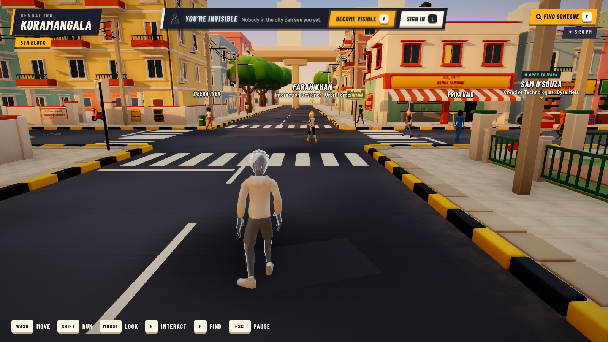

# People of City

[](LICENSE) [](https://github.com/peopleofcity/peopleofcity/actions/workflows/checks.yml) [](CONTRIBUTING.md)

**A stylised 3D city you walk through, where every character is a real person.**



This is the open base of [People of Bengaluru](https://peopleofbengaluru.com): the city you walk around, the people you meet in it, connecting, chatting and the live city, as it stood on 10 November 2026. We made it, we're opening it up, and we want to see your city.

## Build your city

Fork it and make **People of _your_ city**: your streets, your landmarks, your people.

- **Built something cool?** Open a pull request or tag us. If we love it, we'll bring it into People of Bengaluru and give you a shout-out.
- **Your city, your rules**, under the license below: anyone who runs a modified version publicly shares their source too, so every city can learn from every other.

## What's inside

- **The city:** a Bengaluru neighbourhood built in code from a hand-arranged kit of bevelled pieces, with stylised lighting and day and night (Next.js + React Three Fiber).
- **The people:** real profiles as walking characters, with name plates, what they're looking for, and profiles you can open.
- **Getting in:** invite codes and applications, reviewed in an admin.
- **Connect and chat:** only matched people can chat.
- **The live city:** see who's online and where, in real time (Cloudflare Workers + Durable Objects, in `realtime/`).
- **The design bible:** `design.md` (the look), `sounddesign.md` (the sound) and `claude.md` (how the whole thing is built and why). Read them before changing anything visual.

## Run it

You'll need Node 22, a [Supabase](https://supabase.com) project, and a [Cloudflare](https://cloudflare.com) account for the live city.

What's **not** included: People of Bengaluru's database migrations, its email templates and sending, and its payments. In their place are small fillers (`src/lib/server/email/send.ts`, `src/lib/server/dodo.ts`) that send nothing, so you plug in your own.

```bash
npm install
cp .env.example .env.local     # fill in your Supabase URL and keys
npm run dev                    # the city at http://localhost:3000
npm test                       # the tests
```

- **Database:** bring your own. The code shows what it reads and writes (profiles, invites, applications, connections, messages); design your tables in Supabase with row-level security on.
- **Email and payments:** replace the fillers with your provider (any transactional email service; any payment provider, if you want a paid application).
- **Live city (optional):** put your Supabase URL and publishable key in `realtime/wrangler.toml` (the `YOUR_…` placeholders), then `npm run rt:dev`, and set `NEXT_PUBLIC_REALTIME_URL=http://localhost:8787` in `.env.local`.

## Contributing

Read [CONTRIBUTING.md](CONTRIBUTING.md). Be kind: [Code of Conduct](CODE_OF_CONDUCT.md). Security issues: [SECURITY.md](SECURITY.md), privately.

## License

[GNU AGPL-3.0](LICENSE). Use it, change it and run it. If you run a modified version for others, including as a website, publish your source under the same license.

Copyright © 2026 People of Bengaluru.
